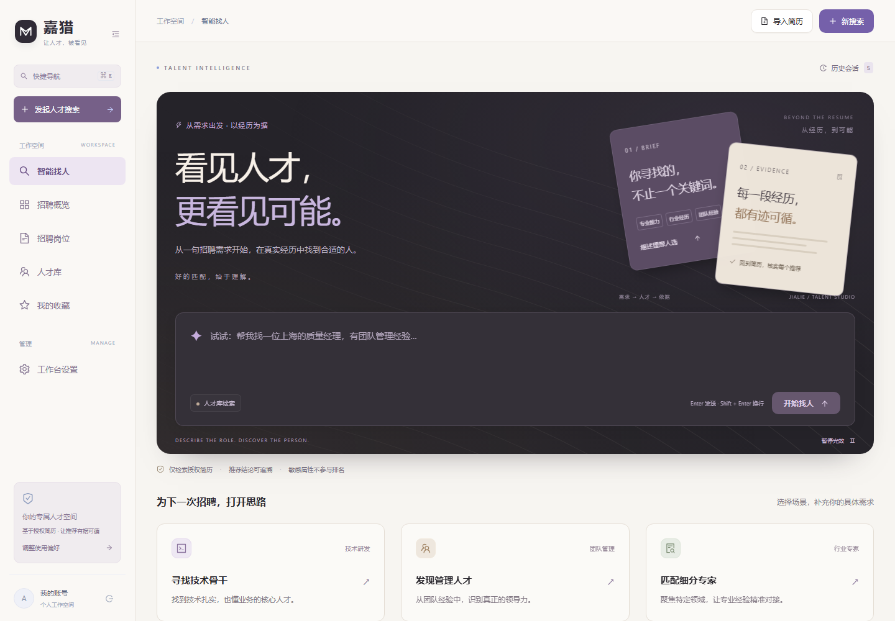
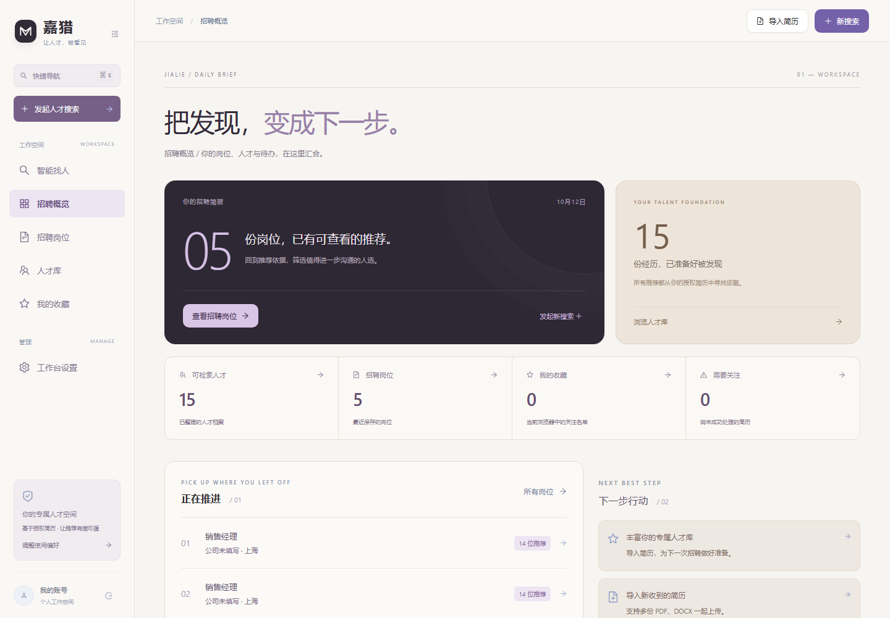
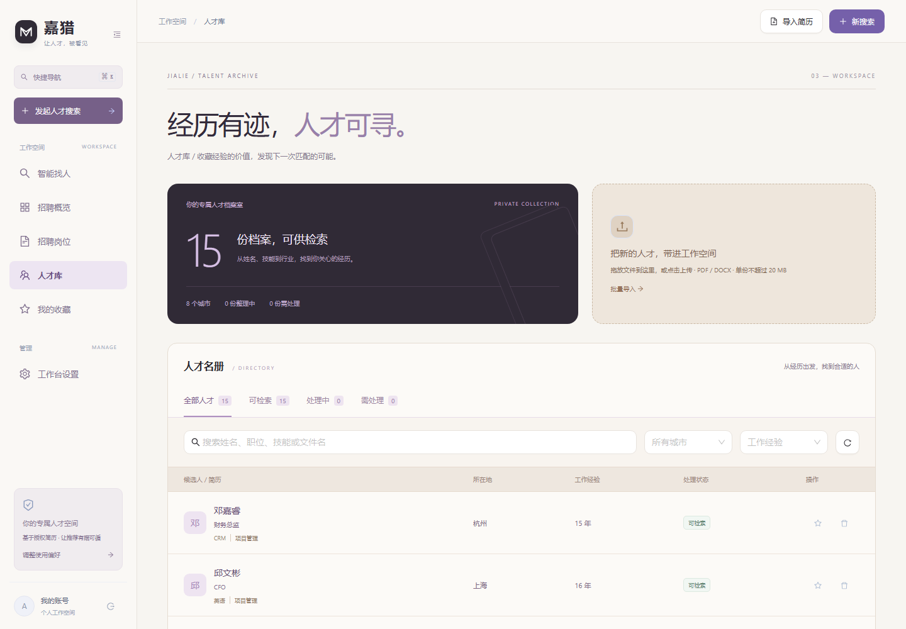
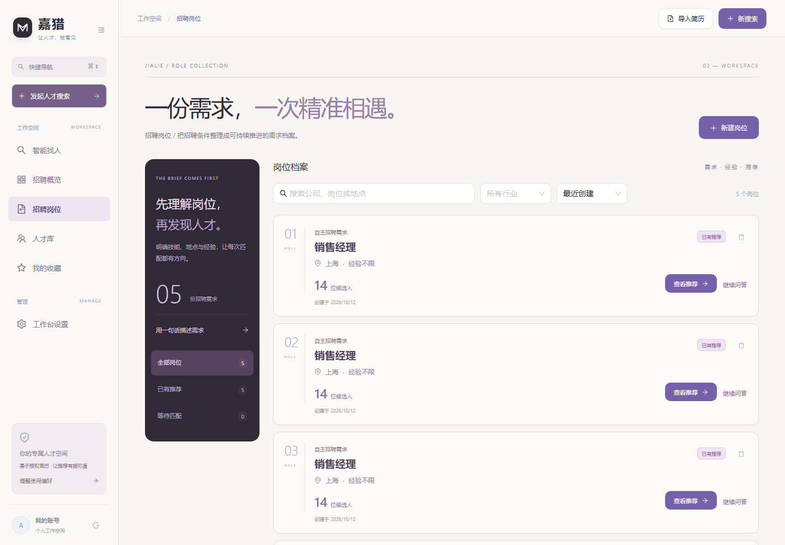
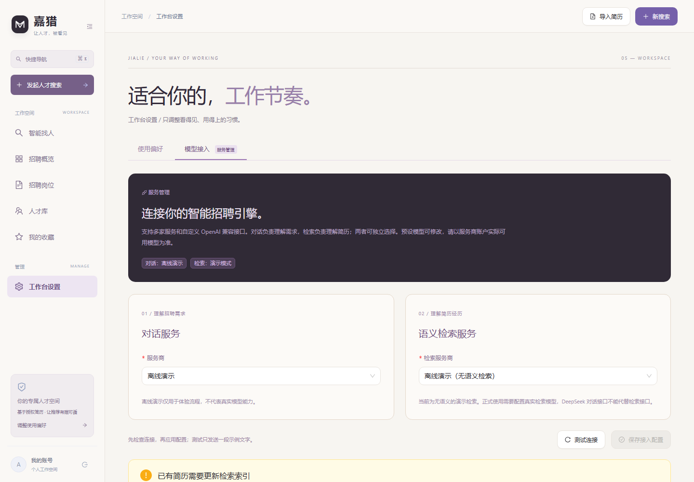
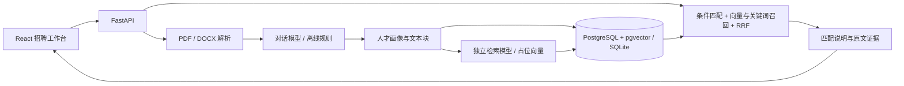

# 嘉猎 · 智能招聘工作台

**从一句招聘需求出发，在简历经历中找到合适的人。**

嘉猎是面向招聘负责人和招聘顾问的 RAG 人才检索工作台。导入已授权的简历后，可以用自然语言描述岗位、连续补充条件，查看推荐依据与简历原文，再收藏并对比候选人。

前端采用 React、TypeScript、Ant Design 与 Motion，后端采用 FastAPI；支持本机 SQLite 开发和 PostgreSQL + pgvector 部署。没有模型密钥时，也可以使用离线演示模式体验业务流程。

> 推荐用于辅助筛选，不代表录用结论。系统不使用性别、年龄、民族等敏感属性参与排名。离线演示使用规则与哈希占位向量，不代表真实模型或语义检索效果。

[界面预览](#界面预览) · [快速启动](#快速启动) · [模型接入](#模型接入) · [使用流程](#使用流程) · [测试与评测](#测试与评测)

## 界面预览

以下为新版工作台实际运行截图，使用离线演示配置与虚构简历，不包含真实客户数据。页面数量和推荐结果随本地数据变化。

### 智能找人

自然语言搜索入口结合场景建议、历史会话和连续追问。背景光束、透视卡片与跟随描边参考 [Aceternity UI](https://ui.aceternity.com/components)，支持暂停动效与系统减少动态效果偏好。



### 招聘概览

岗位进展、人才资产与下一步行动集中呈现，可以直接进入对应任务。



### 人才库

拖放导入、处理状态、姓名与技能搜索、城市与经验筛选，共同组成可持续维护的人才名册。



### 招聘岗位

紧凑岗位档案配合状态筛选与排序；新建岗位后直接打开详情进行匹配，已有会话可继续追问。



### 工作台设置

「使用偏好」提供发送方式、展示人数和证据展开设置；「模型接入」供服务负责人独立配置对话与检索服务。



更多交互与组件来源见 [前端设计说明](frontend/DESIGN.md)。

## 能做什么

| 使用场景 | 当前能力 |
| --- | --- |
| 导入人才 | 批量导入文本型 PDF、DOCX，去重、异步解析并显示处理状态 |
| 描述招聘需求 | 自然语言提取岗位、行业、地点、经验、技能和管理要求，多轮追问补充条件 |
| 查找候选人 | 结构化条件匹配、向量与关键词混合召回、招聘领域同义词扩展 |
| 核实推荐 | 展示匹配亮点、待核实信息和原文引用，进入档案查看经历 |
| 推进岗位 | 创建岗位、查看推荐、重新匹配、继续关联问答 |
| 收藏与对比 | 收藏候选人，选择 2–3 人并排比较经验、技能与履历亮点 |
| 连续操作 | 可收起侧栏、Ctrl / Cmd + K 快捷导航、切页保留草稿、筛选与滚动位置 |
| 接入模型 | 多家服务商预设、自定义兼容接口、草稿连接测试与服务端保存 |

偏好和收藏 ID 保存在当前浏览器，收藏不跨设备同步；候选人资料从鉴权 API 读取。页面状态在当前登录会话内保留，退出登录后清空。调用审计保留在后端，客户导航不展示内部运行轨迹和评分分项。

## 快速启动

### 本机开发

准备 Python 3.12、Node.js 22 和 Git。以下命令以 Windows PowerShell 为例。

```powershell
git clone https://github.com/Alen-hjm/JiaLie-RAG.git
cd JiaLie-RAG
Copy-Item .env.example .env
```

编辑根目录 `.env` 中的 `SECRET_KEY`、`ADMIN_USERNAME` 和 `ADMIN_PASSWORD`。首次启动前设置自己的密钥与密码；离线体验保持 `MODEL_MODE=mock`、`EMBEDDING_PROVIDER=hash`。

启动后端：

```powershell
cd backend
python -m venv .venv
.\.venv\Scripts\python.exe -m pip install -r requirements.txt
.\.venv\Scripts\python.exe -m app.bootstrap
# 可选：导入仓库提供的虚构简历
.\.venv\Scripts\python.exe -m scripts.seed_demo
.\.venv\Scripts\python.exe -m uvicorn app.main:app --reload --port 8010
```

另开终端启动前端：

```powershell
cd frontend
npm ci
npm run dev
```

打开 [http://localhost:5173](http://localhost:5173)，使用 `.env` 中配置的管理员账号登录。API 文档位于 [http://localhost:8010/api/docs](http://localhost:8010/api/docs)，健康检查为 `GET /api/health`。

Linux / macOS 可用 `cp .env.example .env`，将上述虚拟环境命令替换为 `.venv/bin/python`。Vite 将 `/api` 请求代理至 `http://localhost:8010`。`bootstrap` 负责建表、初始化管理员与上传目录，不会重新解析已有简历。

### Docker 部署

复制并修改根目录 `.env` 后执行：

```bash
docker compose up --build -d
# 可选：导入虚构演示数据
docker compose exec api python -m scripts.seed_demo
```

前端端口为 `5173`，API 端口为 `8010`。Compose 自动使用 PostgreSQL + pgvector，并通过独立卷保存数据库和简历文件；本机开发继续使用 SQLite。

**当前 Docker 配置通过 `env_file` 注入环境变量，优先级高于页面写入的 `.env` 文件。** 容器部署请在宿主机 `.env` 修改模型配置，再执行下面的命令重新创建 API 容器；单纯重启或在页面点击保存不能覆盖已经注入的变量。

```bash
docker compose up -d --force-recreate api
```

## 模型接入

对话模型负责理解招聘需求、解析简历与生成说明；检索模型负责将简历转换为语义向量。两者可以来自不同服务商，密钥独立填写，不会自动复用。

| 服务 | 对话 | 语义检索 |
| --- | --- | --- |
| DeepSeek | 支持 | 需另选检索服务 |
| 阿里云百炼 | 支持 | 支持 |
| 硅基流动 | 支持 | 支持 |
| 智谱 | 支持 | 支持 |
| OpenAI | 支持 | 支持 |
| 自定义兼容接口 | 需兼容 Chat Completions 与项目所需结构化输出 | 需兼容 `/embeddings` |
| 离线演示 | 规则模拟 | 哈希占位向量，无语义 |

这里的「支持」指已提供配置和调用通路；预设模型是否可用取决于服务商账户、区域和权限。本轮未逐家完成真实云端验收。

### 在页面配置

适用于从根 `.env` 读取配置的本机部署：

1. 打开「工作台设置 → 模型接入」。
2. 分别选择对话和检索服务商，填写对应 API Key。预设地址与模型名称可按账户实际可用模型修改。
3. 自定义接口填写服务根地址，如 `https://example.com/v1`，不要附加 `/chat/completions` 或 `/embeddings`。自定义检索模型的原生维度在折叠的「自定义模型选项」中设置。
4. 点击「测试连接」。测试仅发送示例文字，不发送库内简历；检查对话结构化输出与检索向量维度。
5. 检查通过后保存。选择离线模式时会明确提示未连接远程服务，不会把演示结果当成真实连接成功。
6. 如果已有简历且更换了检索服务，按下一节更新索引，再进行真实搜索验收。

密钥保存到服务端 `.env`，不写入浏览器存储；页面不回显完整密钥，离开设置时清空密钥输入。已有密钥时留空表示保留，更换服务商请填写对应密钥。当前一次启用一套对话配置和一套检索配置，尚不支持多配置档案或自动故障切换。

### 使用环境文件配置

例如，DeepSeek 对话搭配硅基流动检索：

```dotenv
MODEL_MODE=deepseek
CHAT_BASE_URL=https://api.deepseek.com
CHAT_MODEL=deepseek-chat
CHAT_API_KEY=your-chat-key

EMBEDDING_PROVIDER=siliconflow
EMBEDDING_MODE=real
EMBEDDING_API_KEY=your-embedding-key
EMBEDDING_BASE_URL=
EMBEDDING_MODEL=
EMBEDDING_DIMENSIONS=0
```

检索地址、模型留空及维度为 `0` 时使用服务商预设。自定义对话使用 `MODEL_MODE=openai` 并填写对应的 `CHAT_*` 字段；自定义检索使用 `EMBEDDING_PROVIDER=custom`，填写地址、模型和实际输出维度。自定义检索请求不额外发送 `dimensions` 参数，而是使用模型原生输出。

本机手工修改文件后重启后端。操作系统环境变量优先于 `.env`，请避免同一配置同时由多个来源管理。

### 更新已有简历的检索索引

更换检索服务、模型或维度后，即使维度相同也应全量更新，避免混用不同模型生成的向量。在 `backend` 目录执行：

```powershell
.\.venv\Scripts\python.exe -m scripts.reindex_embeddings --dry-run
.\.venv\Scripts\python.exe -m scripts.reindex_embeddings --force --rebuild-index
```

Docker 使用：

```bash
docker compose exec api python -m scripts.reindex_embeddings --force --rebuild-index
```

重建按批处理，并记录配置指纹。失败记录写入 `backend/eval/reindex_failed.json`，脚本返回非零状态并保留待更新标记；排除服务错误后重新运行。提供 `--only-failed` 选项，但配置指纹仍不匹配时会优先执行全量重建。远程索引更新会调用检索服务并可能产生费用。

完成后在设置页点击「重新读取」，确认待更新提示消失。`GET /api/health` 的 `embedding_is_placeholder=false` 表示已配置远程检索条件，实际连通性仍以连接测试和检索结果为准。

## 使用流程

1. 登录并确认数据处理告知，在人才库导入已授权简历，或使用虚构演示数据。
2. 等待处理完成，在首页描述需求，例如「寻找上海销售经理，5 年以上经验，有团队管理经历」。也可参考 [半导体销售总监示例](docs/demo-jd.md)。
3. 连续追问补充行业、技能或管理要求，查看候选人的匹配亮点与待核实信息。
4. 展开原文证据，进入候选人档案核实经历；返回后继续当前筛选。
5. 收藏感兴趣的人选，在「我的收藏」勾选 2–3 人进行对比。
6. 在「招聘岗位」查看推荐、重新匹配或继续关联问答；也可以手动创建岗位再匹配。
7. 在「招聘概览」查看岗位进展和待处理简历，在「使用偏好」调整自己的操作习惯。

## 技术架构



- 混合召回：向量与关键词分别召回，用 RRF 融合；PostgreSQL 支持 pgvector 与 HNSW 索引。
- 招聘领域同义词扩展：扩大关键词召回范围，不直接改变打分权重。
- 默认评分：35% 结构化条件、45% 语义相关、20% 证据覆盖；客户页面侧重可理解的说明与原文。
- 可选编排：`ORCHESTRATION_MODE=langgraph` 启用召回质量评估与有界查询改写，失败退回固定流水线。
- 可选重排：`RERANK_MODE=rule|llm`，默认规则模式；大模型调用失败时降级。
- 后端审计记录模型、耗时、Token、状态与请求哈希，不默认保存完整提示词。

## 测试与评测

本轮本机验证（2026-10-12）：

| 检查 | 结果与范围 |
| --- | --- |
| 前端测试 | 7 项通过 |
| 后端测试 | 58 项通过 |
| 生产构建 | 通过，仍有主包超过 500 kB 的体积提示 |
| 浏览器业务流程 | 登录、演示连接检查与保存、离页密钥清空、DOCX 导入解析、建岗匹配、搜索追问、原文证据、收藏对比、退出登录通过 |
| 响应式 | 岗位与模型接入页在 390 / 820 像素宽度下无横向溢出 |
| 真实云端模型 | 本轮未提供有效密钥，真实连通性与语义效果尚未验收 |

重新运行自动化检查：

```powershell
cd backend
.\.venv\Scripts\python.exe -m pytest -q
cd ../frontend
npm ci
npm test
npm run build
```

### 历史检索评测

以下数据来自仓库保存的历史报告，**不是本轮界面改造后的重新评测结果**。语料为 17 位虚构候选人、37 个文本块、8 条样例，使用 `zhipu:embedding-3` 真实向量（1024 维），相关度阈值为 grade ≥ 2。

| 指标 | 纯向量召回 | 混合召回 | 混合召回 + 同义词扩展 |
| --- | --- | --- | --- |
| Recall@5 | 0.8646 | 0.8646 | **0.9688** |
| Recall@10 | 0.9583 | 0.9583 | **1.0000** |
| Precision@5 | 0.4000 | 0.4000 | **0.4500** |
| MRR | 0.9375 | 0.9375 | 0.9375 |
| NDCG@5 | 0.8718 | 0.8718 | **0.9062** |
| NDCG@10 | 0.9084 | 0.9078 | **0.9300** |

来源：[纯向量](backend/eval/results_fusion_vector_only.json)、[混合召回](backend/eval/results_hybrid.json)、[同义词扩展](backend/eval/results_synonym_on.json)。该小规模样例集用于回归和方案比较，不能据此推断真实招聘场景的准确率。

[黄金集](backend/eval/gold.json) 使用文档 SHA-256 标识，文件重生成导致哈希变化时支持姓名兜底；替换语料后应检查预期候选人是否成功解析。历史大模型重排对比使用了占位向量，其结论不应外推至真实语义检索，原始报告见 [规则重排](backend/eval/results_rerank_rule_deepseek.json) 和 [大模型重排](backend/eval/results_rerank_llm_deepseek.json)。

在后端虚拟环境中运行：

```bash
python -m scripts.evaluate --fusion vector_only --rerank rule --out eval/results_fusion_vector_only.json
python -m scripts.evaluate --fusion hybrid --rerank rule --out eval/results_hybrid.json
python -m scripts.evaluate --fusion hybrid --rerank llm --out eval/results_rerank_llm_deepseek.json
python -m scripts.evaluate --list-candidates
```

评测结束后自动清理创建的评测岗位与匹配记录，使用 `--keep` 可保留。

## 数据与部署边界

- 当前账号模型为管理员账号，尚无客户与服务管理员的角色隔离。模型接入会影响整个工作台，面向独立客户账号开放前需要补充授权与数据隔离。
- 真实简历、数据库、上传目录、日志和 `.env` 不应提交到 Git；仓库忽略规则已覆盖常用路径。密钥当前保存在服务端文件中，尚未接入专用密钥管理服务。
- 启用远程对话或检索服务时，相应的简历文本会发送给所配置的服务商，应事先取得授权并确认数据保留政策。
- `MASK_PII=true` 默认对证据引用和发送给模型的文本中的手机号、邮箱、身份证打码；原始文档与库内数据保持不变。候选人详情中的联系方式尚未统一脱敏。
- 收藏 ID 和偏好保存在当前浏览器，尚无跨设备同步。业务数据并非多租户隔离。
- 删除候选人会级联删除画像、经历、文本块、向量、匹配记录和对应本地原文件。
- 扫描 PDF、图片简历、旧版 `.doc` 与 OCR 暂不支持。
- 当前部署模板适合本机或内网试用；公网交付仍需配置 HTTPS、会话 Cookie 安全策略、访问控制与备份。

## 项目结构

```text
backend/
  app/                 API、鉴权、解析、模型服务与检索
  alembic/             数据库迁移
  scripts/             初始化、演示语料、索引重建与评测
  eval/                黄金集与历史评测结果
  tests/               单元与 API 测试
frontend/
  src/pages/           搜索、概览、岗位、人才库、收藏、档案与设置
  src/components/      页面状态保留、模型接入与交互组件
  src/design.css       统一视觉样式
  DESIGN.md            设计说明与 Aceternity 组件来源
docs/
  images/              界面截图
  demo-jd.md           演示招聘需求
docker-compose.yml     PostgreSQL、API 与前端编排
```

## 后续方向

- 客户与服务管理员角色、多人协作和数据隔离。
- 候选人详情统一脱敏、数据保留与导出策略。
- 模型配置档案、容器环境配置持久化与可视化索引任务。
- 真实语义服务回归评测及本地 cross-encoder 重排实验。
- OCR、图片简历与更多导入格式。
- 前端包体积优化、异步数据库访问。
